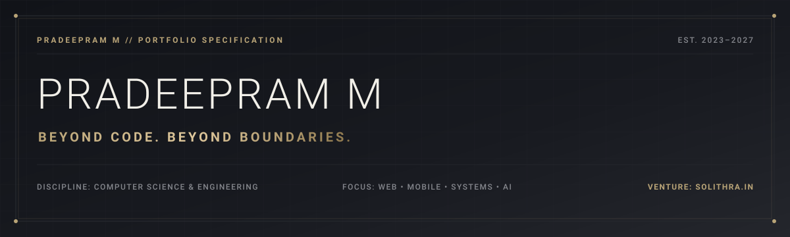

<div align="center">

<!-- HEADER BANNER (ADAPTIVE DARK & LIGHT THEME) -->
<picture>
  <source media="(prefers-color-scheme: dark)" srcset="assets/banner-dark-v2.svg">
  <source media="(prefers-color-scheme: light)" srcset="assets/banner-light-v2.svg">
  
</picture>

<br />

### Multidisciplinary Technologist • Developer • Researcher

<p align="center">
  <em>"Beyond code. Beyond boundaries."</em>
</p>

<!-- STATS & BADGE STRIP -->
<p align="center">
  
  
  
</p>

</div>

---

### `[01]`  OVERVIEW

> I approach technology as a unified continuum — from bare-metal systems and algorithmic foundations to responsive web architectures, mobile product ecosystems, and cognitive AI workflows. 

I am a **Computer Science & Engineering undergraduate (2023–2027)** with a perspective that spans engineering, technical research, and independent platform creation. Rather than confining myself to conventional software silos, I prioritize adaptability: rapidly deconstructing complex systems, evaluating operational trade-offs, and delivering resilient, production-ready solutions across diverse technical domains.

```text
Core Focus       ▸  End-to-End Web Applications • Native Mobile Ecosystems • Applied AI
Engineering Mind ▸  Analytical Research • Empirical Benchmarking • Architectural Rigor
Operating Mode   ▸  Autonomous Discovery • Systems Thinking • Technical Leadership
```

---

### `[02]` PROFESSIONAL CAPABILITIES

<table width="100%">
  <tr>
    <td width="50%" valign="top">
      <h4>🌐 Web Engineering & Architecture</h4>
      <ul>
        <li>Full-cycle web application design and implementation.</li>
        <li>Modular frontend architectures using <b>TypeScript</b>, HTML5, and CSS3.</li>
        <li>Client-driven solution delivery with focus on performance, accessibility, and clean state flows.</li>
      </ul>
    </td>
    <td width="50%" valign="top">
      <h4>📱 Mobile Application Development</h4>
      <ul>
        <li>Cross-surface mobile-web integration and native compilation.</li>
        <li>Hybrid and native runtime development across <b>Android</b> and <b>Capacitor</b> ecosystems.</li>
        <li>Constraint-aware background tasks, offline synchronization, and state management.</li>
      </ul>
    </td>
  </tr>
  <tr>
    <td width="50%" valign="top">
      <h4>🧪 Software Testing & Quality Assurance</h4>
      <ul>
        <li>End-to-end exploratory and functional mobile application testing.</li>
        <li>Defect isolation, boundary fuzzing, and regression verification.</li>
        <li>Security forensics, IPC sanitization, and runtime vulnerability auditing.</li>
      </ul>
    </td>
    <td width="50%" valign="top">
      <h4>🧠 Research, Exploration & Applied AI</h4>
      <ul>
        <li>Algorithmic modeling, empirical benchmarking, and mathematical simulations.</li>
        <li>Adoption and integration of modern Large Language Model (LLM) workflows.</li>
        <li>Technology feasibility studies, architectural diagnosis, and protocol evaluation.</li>
      </ul>
    </td>
  </tr>
</table>

---

### `[03]` TECHNICAL SPECTRUM

<div align="left">

#### Languages & Core Computing
<p>
  
  
  
  
  
  
</p>

#### Frameworks, Mobile & Backend
<p>
  
  
  
  
  
</p>

#### Tools, Engineering & Design
<p>
  
  
  
  
  
</p>

</div>

---

### `[04]` RESEARCH & EXPLORATION INITIATIVES

My work prioritizes foundational inquiry, mathematical grounding, and experimental verification:

* **Wireless Resource Allocation & Interference:** Formulated hexagonal spatial reuse strategies, Erlang-B traffic capacity limits, and Monte-Carlo Signal-to-Interference Ratio (SIR) distribution engines.
* **Mobility Management Protocols:** Investigated Mobile IP triangular routing bottlenecks, reverse tunneling under ingress filtering, and self-healing multi-hop MANET routing algorithms (AODV, DSDV).
* **Mobile Runtime Systems Forensics:** Comparative profiling of Android Runtime (ART) Ahead-of-Time / Just-in-Time compilation models against legacy interpreters, garbage collection pause profiles, and IPC security boundary verification.

---

### `[05]` PROFESSIONAL OPPORTUNITIES

I am actively open to internships, technical projects, and collaborative roles across forward-thinking engineering teams:

```text
✦ Web Engineering & Modern Full-Stack Development
✦ Mobile Application Engineering (Android & Cross-Platform)
✦ Software Quality Assurance & Application Testing
✦ Applied R&D and Emerging Technology Prototyping
✦ AI Integration, Prompt Workflows & Tooling
✦ Product Engineering & Technology Strategy
```

> **Why collaborate?** I bring high cognitive flexibility, strong technical foundations, and a multidisciplinary perspective capable of translating conceptual product roadmaps into dependable software architectures.

---

### `[06]` INDEPENDENT VENTURE

<div align="center">
  <table width="100%">
    <tr>
      <td align="center" style="padding: 24px;">
        <h2 style="letter-spacing: 2px; margin-bottom: 4px;">S O L I T H R A</h2>
        <p><b>An Independent Open Publication & Knowledge Platform</b></p>
        <p style="max-width: 650px; color: #85878D; margin: 12px auto;">
          Solithra is an autonomous digital platform founded and operated to empower researchers, writers, and technologists to publish original case studies, analytical essays, perspective pieces, and technical insights.
        </p>
        <p>
          <a href="https://solithra.in">
            
          </a>
        </p>
      </td>
    </tr>
  </table>
</div>

---

### `[07]` LEADERSHIP & INTELLECTUAL PURSUITS

Beyond software and research, my perspective is shaped by disciplines requiring strategic vision and operational discipline:

* **Technology Trends & Hardware Ecosystems:** Constantly tracking silicon advancements, mobile SoC evolutions, and edge computing paradigms.
* **Environmental Observation & Travel:** Exploring diverse environments to observe human behavior, architectural forms, and regional operational dynamics.
* **Continuous Cross-Disciplinary Learning:** Synthesizing ideas across design, technical engineering, and business strategy.

---

### `[08]` CONNECT & COLLABORATE

<div align="center">

<p>I welcome discussions regarding engineering opportunities, research collaborations, or technology strategy.</p>

<p>
  <a href="mailto:pradeepramm@outlook.in">
    
  </a>
  &nbsp;
  <a href="https://github.com/PRADEEPRAMM05">
    
  </a>
  &nbsp;
  <a href="https://solithra.in">
    
  </a>
</p>

<sub>© 2026 PRADEEPRAM M — Built with precision and purpose.</sub>

</div>
